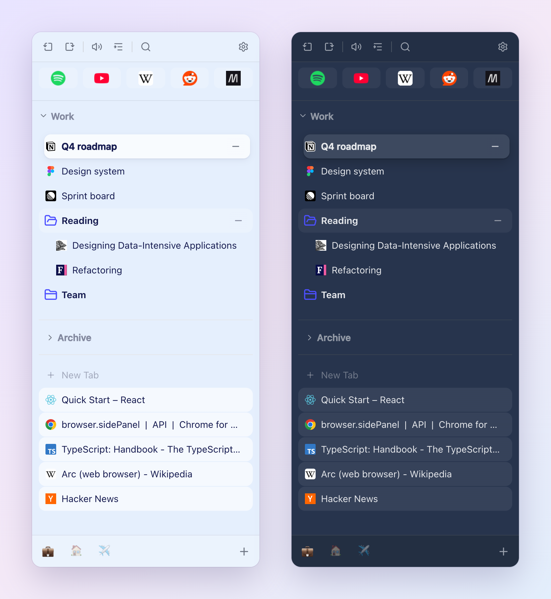
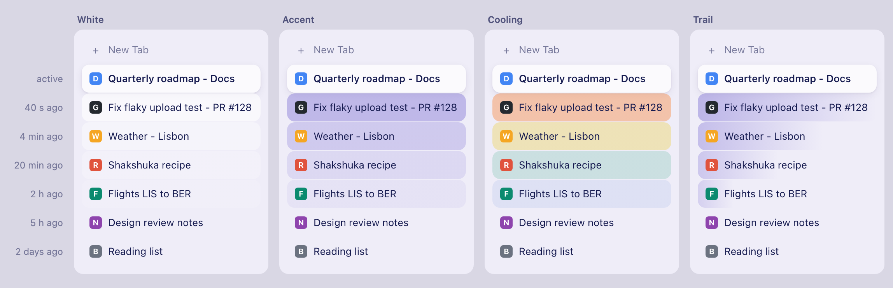
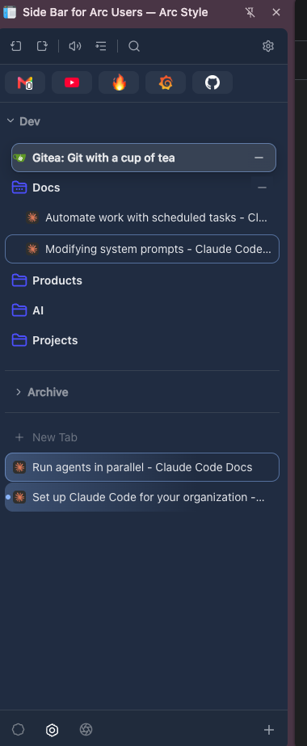

# Side Bar for Arc Users — Arc Style

Arc's sidebar in Chrome's Side Panel. Favorites, pinned pages, folders and tabs sit in one vertical list, grouped into Spaces, and behave the way they do in Arc wherever Chrome's extension APIs allow it.

Chrome still draws its own tab strip, address bar and Side Panel header. An extension can't replace those, so the work goes into everything inside the panel.



## Install

The extension is not in the Chrome Web Store. The "Sidebar for Arc Users" listing there is the upstream project, not this fork.

Build it from source (Node.js 18+):

```bash
git clone https://github.com/rashpile/SideBarforArcUsers.git
cd SideBarforArcUsers
make install
make build
```

Then open `chrome://extensions`, turn on **Developer mode**, click **Load unpacked** and pick the `dist/` folder. Open the sidebar with the extension icon or `Cmd+Shift+E` (`Ctrl+Shift+E` on Windows and Linux).

To update, run `git pull && make build` and press reload on the extension's card in `chrome://extensions`.

Coming from Arc? **Import from Arc Browser...** in the sidebar menu reads Arc's `StorableSidebar.json` and brings over your Favorites, Spaces and pinned pages. Arc's Favorites go into every Space the import creates, or into the active Space when it creates none.

## How it fits together

- **Favorites** are the icon grid at the top. Each Space has its own; switching Space switches the grid.
- **Spaces** each link one bookmark folder with their own set of tabs, plus a name, icon and color. You see one Space at a time and switch from the bar at the bottom.
- **Pinned pages** are the bookmarks in the Space's folder. Click one and it opens as its tab. Close the tab and the bookmark stays in place, like a pinned tab in Arc.
- **Tabs** below the bookmarks are the Space's other open tabs.
- **Archive** keeps tabs you archive by hand or stopped using, if you turn auto-archive on.

Everything is stored in Chrome: bookmarks for Spaces, pinned pages, the archive and Favorites, and the extension's local storage for settings, Favorite icons and marks. Nothing goes to a server, except what AI naming and the page agent send to the AI endpoint you set up. See [PRIVACY.md](PRIVACY.md).

## Features

### Favorites

- Icon grid at the top of the panel. Tile height follows the **Pinned icon size** setting (12-48px)
- Each Space has its own Favorites, stored as bookmarks in an `asd_Favorites` folder inside the Space's folder, so they sync with Chrome bookmarks and survive reinstalling the extension. Custom icon, emoji and color stay in the extension's local storage
- A Space without a bookmark folder has no Favorites; the grid says so and pinning does nothing there
- After the update from global Favorites, the old list is copied once into every Space that has a bookmark folder. With bookmark sync, a second computer adds only the old Favorites the first one didn't have
- Right-click a bookmark or a tab and pick **Pin to Sidebar** to add it. Drag to reorder
- Custom icon, emoji and color per Favorite
- Click opens it as an Arc-style tab. `Cmd/Ctrl+Click` opens a background tab, `Shift+Click` a new window
- A dot marks an open Favorite, a triangle one that plays audio
- Double-click a Favorite whose tab moved on to another page to load the Favorite's page back in that tab
- Right-click: Edit (title, URL, icon, color), Duplicate, Reset favicon, Unpin, Move to Space, Move to New Window. Move to Space moves the Favorite to another Space's Favorites, and its open tab goes with it

### Bookmarks and pinned pages

- The Space's bookmark folder as a tree
- Click a folder row to expand or collapse it. A collapsed folder still shows its open and marked pages, the active one as a card
- Hover or click the search button on a folder row to see its recently used pages, newest first, with search. The Space title has the same button for the whole Space folder
- Collapse the whole section with the chevron on the Space title. Open and marked pages stay visible. The state is kept per Space and shared across windows
- Double-click a bookmark whose tab moved on to another page to load the bookmarked page back in that tab
- Links you open from a bookmark or Favorite page (`Cmd+Click`) land at the top of the Tab list
- A tab you open yourself on a bookmarked or Favorite URL stays in the Tab list. In Arc style, clicking that bookmark or Favorite opens a second tab for it; dragging the tab onto the tree, **Add to Bookmark**, pinning it or dropping it on the Favorites grid makes a new bookmark or Favorite with that tab as its page. Tabs reopened from the Archive also land in the Tab list
- Drag and drop to organize. Drag a tab onto the tree to bookmark it
- `...` menu: New Folder, New Bookmark, Sort by Name/Date, Copy as YAML, Paste from YAML..., Edit, Duplicate, Delete, Pin, Move to New Window, Expand All, Open as Tab Group
- **Copy as YAML** puts the folder, its subfolders and bookmarks on the clipboard as YAML. **Paste from YAML...** opens a box for YAML text and adds the folders and bookmarks to the end of the folder; same-named folders are not merged. The box shows what it will create ("3 folders, 12 bookmarks") or the line and reason of each error, and nothing is created until the whole text is valid. A URL without `https://` gets it added. One Undo removes the whole paste. `asd_Archive` and `asd_Favorites` are left out of a copy and can't be pasted. The format:

  ```yaml
  - folder: "Tools"
    items:
      - title: "GitHub"
        url: "https://github.com"
      - folder: "Docs"
        items: []
  - title: "Inbox"
    url: "https://mail.google.com"
  ```

  A bookmark has `url` and an optional `title` (the URL is used when it is missing); a folder has `folder` and `items`.
- Right-click a bookmark: Copy Link, Share, AI Rename, Edit, Mute/Unmute, Duplicate, Move to..., Remove Pin, Mark for Attention, Pin to Sidebar. With several bookmarks selected, **Pin to Sidebar** pins them all. **Edit** opens a submenu: **Replace Pinned URL with Current** (when the page is open) saves the tab's current address as the bookmark's URL and keeps its title; **Edit Pinned Page** opens the dialog to change title and URL
- Hover a bookmark for a flag button that marks it for attention. A speaker icon shows pages playing audio, an X on hover closes the tab

### Tabs

- The current Space's tabs that aren't pinned pages
- Recently left tabs get a stronger background that fades over 3 hours. Pick White, Accent, Cooling or Trail in Settings, or turn it off

  

- A dot at the left edge marks a tab opened in the background (`Cmd+Click`, "Open link in new tab") until you first switch to it. Turn it off with **Mark unvisited tabs** in Settings
- Drag to reorder, click to switch. On hover, a flag button marks the tab for attention, the Archive button saves it to the Archive and closes it, and X closes it. Marked tabs and empty pages have no Archive button, and neither does a Space without a bookmark folder
- "+ New Tab" row at the bottom. Its `...` menu has **Archive** (save the list's tabs to the Archive, then close them) and **Clear** (close them). Both can be undone. Archive is grayed out in a Space without a bookmark folder
- Right-click: Pin to Sidebar, Add to Group, Add to Bookmark, Move to New Window, Duplicate, Mark for Attention, Archive, Close, Close Tabs Before / After / Other Tabs
- With several tabs selected, **Archive** in the right-click menu archives them all; marked tabs stay open. Every Archive can be undone
- Sort by domain, then title (A-Z or Z-A)
- **Recently Closed**: a clock button on the Space title, shown on hover when the Space has closed tabs. Hover or click it for the Space's recently closed tabs, newest first, with the time each was closed. Click one to reopen it in the current window, in that Space (without its Back/Forward history). **Clear** empties the Space's list. Up to 50 tabs per Space are kept, across browser restarts; closing a page again replaces its older entry
  - Not recorded: tabs closed by auto-archive or the Archive button (they are in the Archive), tabs of bookmarks and Favorites, tabs a tab suspender replaces with its park page, incognito tabs and internal pages (`chrome://`, the New Tab page and the like)
- Chrome tab groups show with their color and title. Group menu: New Tab, Sort by Domain, Save to Bookmarks, Rename, Change Color, Close All. Drag tabs in and out of groups, reorder groups, drop a group on the bookmark tree to save it as a folder

### Mark for Attention

Hover a tab or a bookmark and click the flag button, or right-click it and pick **Mark for Attention**, to flag it for later. A marked row gets a thin ring in the active Space's colour; pick another colour or strength with **Mark for Attention colour** in Settings. The Space colour option takes the colour of the active Space (theme violet in the All view). On a marked row the item and the button read **Clear Mark**.



- With several tabs or bookmarks selected, one item applies to all of them: if any is unmarked it marks them all, otherwise it clears them all. Folders can't be marked
- On a marked tab the close button shows `-` instead of `x`. Click it to clear the mark; the tab stays open
- Commands that close many tabs at once leave marked tabs open: Close Tabs Before / After, Close Other Tabs, closing a multi-selection, Close Tabs in Group, Clear and Archive in the "+ New Tab" row's `...` menu, archiving a multi-selection or dropping it on the Archive, and Close All Tabs In Space. A tab's own **Close** still closes it
- Auto-archive never closes a marked tab. A marked bookmark doesn't keep its open tab from being archived
- A marked bookmark stays visible in a collapsed folder and in the collapsed Bookmarks section, open or not
- Marks survive closing the sidebar, an extension restart and a browser restart. Incognito tabs can't be marked

### Spaces

- A Space is a bookmark folder plus a set of real Chrome tabs, with a name, icon and color
- One Space is visible at a time. There is no "All" view
- Switch with the icons at the bottom or a two-finger swipe. Switching brings the Space's most recently used tab forward. A Space with no tabs opens a new tab
- New tabs (`Cmd+T`) belong to the active Space
- Space membership doesn't depend on Chrome tab groups. Your own groups work normally inside a Space, and moving a tab between windows keeps its Space
- Create with "+" in the bar: name, icon, color and bookmark folder (created if missing)
- Right-click a Space icon to edit or delete it. The last Space can't be deleted
- The Space title's `...` menu has **Copy Space as YAML** (the Space folder's bookmarks and folders, without `asd_Archive` and `asd_Favorites`) and **Paste from YAML...** (adds to the end of the Space folder). Both work as for a folder and are hidden when the Space has no bookmark folder
- Optionally tint the sidebar with the Space's color
- Use a bookmark folder for one Space only. Two Spaces on one folder aren't blocked, but bookmarks then resolve to whichever Space comes first

### Archive

Off by default. Turn it on with **Archive tabs after** in Settings: 12 hours, 24 hours, 3 days, 7 days or 30 days.

- Tabs from the Tab list that you haven't used for that long are saved as bookmarks in an `asd_Archive` folder inside the Space's folder, then closed
- Open pinned pages unused for that long are closed. Their bookmark stays. If the tab had moved on to another page, that page is archived first
- Empty pages (New Tab, `about:blank`) close without a bookmark
- Never closed: the active tab of each window and the tab next to it in split view, tabs playing audio, Chrome-pinned tabs, tabs marked for attention, Favorites and tabs showing the page of any Space's Favorite, incognito tabs, and tabs with no Space or whose Space has no folder
- "Unused" counts from the moment you switched away, including while Chrome is closed or the computer sleeps
- Turning the setting on starts every tab's clock at that moment, so nothing closes right away
- Archiving a URL again replaces the older item. Archived items are never deleted automatically

The **Archive** section sits between Bookmarks and Tabs. Click the header to list everything, newest first, with the time each was archived. While it is expanded, a search field in the header row narrows the list. Click an item to reopen it in the active Space. Right-click to delete it (with Undo).

Drag a tab or a multi-selection from the Tab list onto the Archive section, collapsed or expanded, to archive them, with Undo. Marked tabs stay open. The section shows once the Archive has an item; until then use the Archive button on a tab row.

The header's `...` menu has **Clear**: Clear All, Older than 24 Hours, Older than 7 Days or Older than 30 Days. It works on the whole Archive of the active Space, whatever the search shows. Each option shows how many pages it removes and is grayed out when there are none. Clear All asks first; the age options run at once. One Undo brings back everything a Clear removed.

The extension hides `asd_Archive` and `asd_Favorites` in the Bookmarks tree, search, Expand All, Open All and folder pickers. Chrome's bookmark bar and Bookmark Manager still show them.

### Search and filters

- Search titles and URLs across Favorites, bookmarks, tabs and the active Space's archive
- Saved filters and the last 5 searches in a dropdown
- Show only items with an open tab, or only items playing audio
- One button clears all filters

### Keyboard

| Shortcut | Action |
| --- | --- |
| `Cmd+Shift+E` / `Ctrl+Shift+E` | Open the sidebar |
| `Cmd+Shift+<` / `Ctrl+Shift+<` | Previous tab in this window's history |
| `Cmd+Shift+>` / `Ctrl+Shift+>` | Next tab in history |
| not set | Tab Switcher: hold the modifier, press to list the Space's tabs (its Favorite tabs included) by last use, press again to move, release to switch |
| not set | Space Switcher: the same for Spaces |

Set or change shortcuts in `chrome://extensions/shortcuts`.

### Page agent (experimental)

Ask an AI model to change how the current page looks. The sparkles button in the toolbar opens a drawer at the bottom of the panel, above the Space bar. Drag its top edge to resize it. Each tab has its own chat, and the drawer shows the chat of the window's active tab. A chip at the top names that tab's site and path.

Type what you want, for example "make the video player full page width". The agent then works in rounds, up to 8 per message:

1. It reads an outline of the page, plus a screenshot when **Model accepts images** is on.
2. It turns the request into conditions it can measure, such as "player width = content width ±2px" or "aspect ratio 16:9 ±1%", and shows them.
3. It applies CSS to the tab, measures the elements and fixes the CSS until the conditions hold.
4. It reports each condition as met or unmet, with the numbers it measured.

A condition the agent couldn't meet shows as unmet. A run that set no conditions, ran out of rounds or was stopped never counts as met. "N steps · show steps" opens the log of every tool call, the CSS and the screenshots.

A second message in the same chat edits the current CSS, so "a bit narrower" works. When the new request replaces an earlier condition, the report shows it as replaced, not failed.

- While the agent works, Send becomes **Stop**
- **Undo** removes everything the agent applied to the tab. **Show CSS** shows the current stylesheet with a Copy button, to put into your own site
- A reload drops the CSS. The chat then says "Page reloaded, changes removed" and offers **Re-apply**. When the tab has moved on to another page of the same site (for example the next video) it says "Page changed, changes removed" and offers **Re-apply** too, which puts the same CSS on the new page. On another site there is no Re-apply, since the CSS was written for the first site
- The agent writes CSS only, never JavaScript. The extension rejects CSS that would load anything from the network (`@import`, `url()` other than `data:`, `image-set()`, and `var()`, which could pick up a URL the page defines) before it reaches the page
- A run stays on the tab it started on when you switch tabs

The agent uses the AI settings of AI naming: Base URL, API key, model, API protocol and reasoning effort. It calls the model with tool calling through the protocol you chose: Responses API or Chat Completions. Auto works as for AI naming: a Base URL ending in `/responses` or `/chat/completions` decides, otherwise it tries the Responses API first and falls back to Chat Completions when the endpoint doesn't have it. The model must support function calling. It needs access to http and https pages; the drawer shows **Grant page access** until you allow it. Screenshots need **Model accepts images** in Settings and access to all pages, which **Grant screenshot access** in the drawer asks for. Without them the agent checks numbers only. If the API rejects images, the run goes on without screenshots and says so.

The input is disabled on pages that aren't http or https, such as `chrome://` and other extensions' pages, and on the Chrome Web Store. On a PDF the run ends with Chrome's error.

Chats last for the browser session. They survive closing the panel. Closing the tab deletes its chat, or the next time a side panel opens if none was open then. Restarting the browser or reloading the extension deletes all chats.

Known limitations:

- Screenshots show only the visible part of the page; the agent doesn't scroll. Chrome captures only the active tab of a window, so on a background tab the agent goes on with numbers
- Closing the side panel stops a running agent. The chat shows the turn as stopped
- Content inside a cross-origin iframe, such as an embedded YouTube player, can't be styled. Only the iframe box can
- The site's own scripts can fight the CSS, and a single-page app that re-renders can break the agent's selectors
- Moving a tab to another window during a chat isn't supported. The panels of both windows may then change its chat
- A reload during a run leaves the agent measuring the unstyled page, so it may apply the CSS again or report conditions as unmet
- Pressing Stop or closing the panel at the moment CSS reaches the page can leave CSS the chat doesn't know about, with no Undo. A reload removes it
- Reloading or updating the extension deletes every chat, while their CSS stays on the pages until they reload
- The page outline, measurements, screenshots, your requests and the CSS go to the AI endpoint you configured. See [PRIVACY.md](PRIVACY.md)

### Settings

Gear menu → Settings:

- Font size (6-36px) and Pinned icon size (12-48px)
- **Open bookmark**: Arc style (pinned pages act as tabs and are hidden from the Tab list), in a new tab, or in the active tab
- **Follow active tab**: switch Space, switch and scroll, or keep the sidebar where it is
- **Archive tabs after**: Never, or 12 hours to 30 days
- **Highlight tabs by last use**: Off, White (default), Accent, Cooling or Trail
- **Mark unvisited tabs**: a dot on tabs opened in the background that you haven't switched to yet. On by default
- **Mark for Attention colour**: the ring around marked tabs and bookmarks - green, blue, orange, red, purple, yellow or the Space colour, each dim, normal or bright (default: Space colour - dim). Space colour follows the active Space whether or not the Space colour tints the sidebar; in the All view it is the theme violet
- Space color tint
- **AI naming**: rename Favorites and pinned pages with an OpenAI-compatible API you configure (endpoint, model, prompt, automatic or manual). The endpoint must use HTTPS; HTTP works only for localhost, e.g. Ollama or LM Studio. A page's Markdown version and the pages listed in its site's `llms.txt` are read only from the page's own site. The page agent uses the same endpoint and model. **Model accepts images** lets the page agent send screenshots; off by default

### Backup

Export the active Space's Favorites, bookmarks and tabs to a JSON file, and import them back: replace or append the active Space's Favorites, replace bookmarks or add them as a subfolder, replace the session or add tabs to the current window. When you replace all bookmarks from a backup that holds `asd_Favorites` folders, every Space gets its Favorites back from them and the backup's Favorites list only restores the active Space's custom icons; other Spaces' Favorites come back with site icons.

Light and dark mode follow your system.

## Permissions

| Permission | Why |
| --- | --- |
| `sidePanel`, `bookmarks`, `tabs`, `tabGroups` | Show and manage bookmarks, tabs and groups |
| `storage` | Settings and sidebar state, stored locally |
| `favicon` | Website icons |
| `scripting` | Read a page's text when you ask for AI naming; read the page's layout and insert or remove CSS when you use the page agent |
| `activeTab` | Draw the Tab and Space Switcher over the current page |
| `alarms` | Check for unused tabs every few minutes while auto-archive is on |
| Optional `http://*/*`, `https://*/*` | Asked for when you use AI naming or the page agent, to read and restyle the page and call your AI endpoint |
| Optional `<all_urls>` | Asked for only when you turn on page agent screenshots, to capture the visible tab |

## More

- [Changelog](docs/changelog.md)
- [Privacy](PRIVACY.md)
- [Development](docs/development.md): build, tests, architecture
- Issues and ideas: [GitHub issues](https://github.com/rashpile/SideBarforArcUsers/issues)

## Credits

This fork started from [monemone-org/ChromeSideBar](https://github.com/monemone-org/ChromeSideBar) by monehsieh, through [lizeyan/SideBarforArcUsers](https://github.com/lizeyan/SideBarforArcUsers), which moved Spaces off Chrome tab groups and rebuilt the visuals after Arc. It is maintained on its own and doesn't merge back upstream. The bigger differences from upstream are one Space at a time, Space membership independent of tab groups, auto-archive, the switchers and the Arc-style visuals.

Licensed under the [Apache License 2.0](LICENSE). Third-party licenses are in [LICENSES.md](LICENSES.md).
