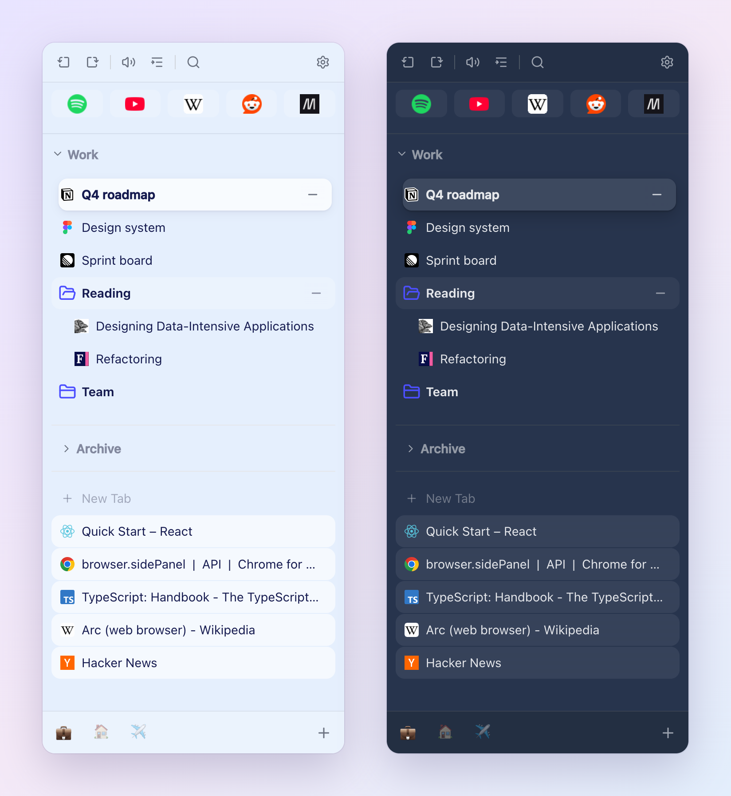
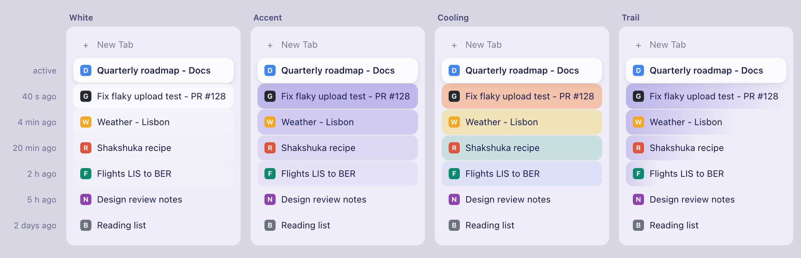
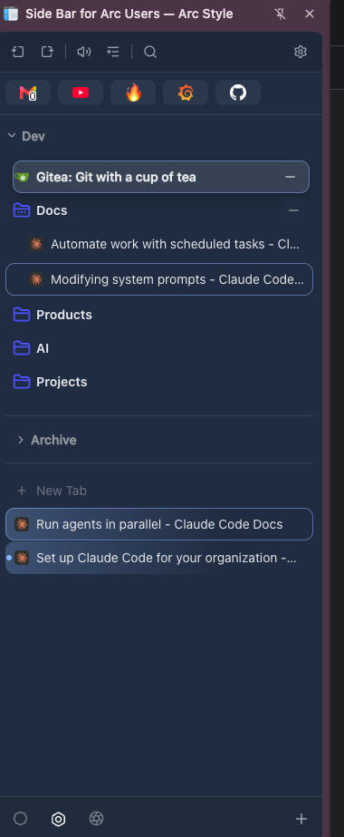

# Side Bar for Arc Users — Arc Style

Arc's sidebar in Chrome's Side Panel. Favorites, pinned pages, folders and tabs sit in one vertical list, grouped into Spaces, and behave the way they do in Arc wherever Chrome's extension APIs allow it.

Chrome still draws its own tab strip, address bar and Side Panel header. An extension can't replace those, so the work goes into everything inside the panel.



## Install

The extension is not in the Chrome Web Store. The "Sidebar for Arc Users" listing there is the upstream project, not this fork.

### Download a release

1. Download `sidebar-for-arc-users-<version>.zip` from the [latest release](https://github.com/rashpile/SideBarforArcUsers/releases/latest). The *Source code* archives GitHub adds to every release are not the extension.
2. Unzip it into a folder you keep, for example `~/Extensions/SideBarforArcUsers`. Most unzip tools (double-click on macOS, Extract All on Windows) make a folder named after the zip, with the version in its name: rename that folder to the one you keep, or unzip from a terminal:

   ```bash
   unzip sidebar-for-arc-users-<version>.zip -d ~/Extensions/SideBarforArcUsers
   ```

3. Open `chrome://extensions`, turn on **Developer mode**, click **Load unpacked** and pick that folder.

To update, delete the files in that folder and unzip the new zip into it. With a double-click unzip, delete the old folder and rename the new one to the old name, in the same place. Then press reload on the extension's card in `chrome://extensions`. Update only with reload: **Remove** on the card deletes the extension's storage, even if you load the same folder again.

Keep the folder path. The manifest has no `key`, so Chrome derives an unpacked extension's ID from its folder path. Loading another folder installs a second copy with its own empty storage: settings (including the AI API key), the Spaces list (names, icons, colors and which bookmark folder each Space uses), custom icons, emoji and colors of Favorites, attention marks, Recently Closed lists and saved page styles. Bookmarks stay: Space folders with their pinned pages, Favorites and archive are Chrome bookmarks, so a Space set up again on its old folder gets them back. Switching between a source build (`dist/`) and a download is a folder change too. If a second copy got loaded, remove the new, empty one, not the one with your Spaces.

### Build it from source

Needs Node.js 22.18 or newer.

```bash
git clone https://github.com/rashpile/SideBarforArcUsers.git
cd SideBarforArcUsers
make install
make build
```

Then open `chrome://extensions`, turn on **Developer mode**, click **Load unpacked** and pick the `dist/` folder.

To update, run `git pull && make build` and press reload on the extension's card in `chrome://extensions`.

### After installing

Open the sidebar with the extension icon or `Cmd+Shift+E` (`Ctrl+Shift+E` on Windows and Linux).

Coming from Arc? **Import from Arc Browser...** in the sidebar menu reads Arc's `StorableSidebar.json` and brings over your Favorites, Spaces and pinned pages. Arc's Favorites go into every Space the import creates, or into the active Space when it creates none.

## How it fits together

- **Favorites** are the icon grid at the top. Each Space has its own; switching Space switches the grid.
- **Spaces** each link one bookmark folder with their own set of tabs, plus a name, icon and color. You see one Space at a time and switch from the bar at the bottom.
- **Pinned pages** are the bookmarks in the Space's folder. Click one and it opens as its tab. Close the tab and the bookmark stays in place, like a pinned tab in Arc.
- **Tabs** below the bookmarks are the Space's other open tabs.
- **Archive** keeps tabs you archive by hand or stopped using, if you turn auto-archive on.

Everything is stored in Chrome: bookmarks for Spaces, pinned pages, notes, the archive and Favorites, and the extension's local storage for settings, Favorite icons, marks, saved page styles and note texts. Nothing goes to a server, except what the page agent sends to the AI endpoint you set up. See [PRIVACY.md](PRIVACY.md).

## Features

### Favorites

- Icon grid at the top of the panel. Tile height follows the **Pinned icon size** setting (12-48px)
- Each Space has its own Favorites, stored as bookmarks in an `asd_Favorites` folder inside the Space's folder, so they sync with Chrome bookmarks and survive reinstalling the extension. Custom icon, emoji and color stay in the extension's local storage
- A Space without a bookmark folder has no Favorites; the grid says so and pinning does nothing there
- After the update from global Favorites, the old list is copied once into every Space that has a bookmark folder. With bookmark sync, a second computer adds only the old Favorites the first one didn't have
- Right-click a bookmark or a tab and pick **Pin to Sidebar** to add it. Drag to reorder
- Custom icon, emoji and color per Favorite
- Click opens it as an Arc-style tab. `Cmd/Ctrl+Click` opens a background tab, `Shift+Click` a new window
- A dot marks an open Favorite, a triangle one that plays audio
- Double-click a Favorite whose tab moved on to another page to load the Favorite's page back in that tab
- Right-click: Edit (title, URL, icon, color), Duplicate, Reset favicon, Unpin, Move to Space, Move to New Window. Move to Space moves the Favorite to another Space's Favorites, and its open tab goes with it

### Bookmarks and pinned pages

- The Space's bookmark folder as a tree
- Click a folder row to expand or collapse it. A collapsed folder still shows its open and marked pages, the active one as a card
- Hover or click the search button on a folder row to see its recently used pages, newest first, with search. The Space title has the same button for the whole Space folder
- Collapse the whole section with the chevron on the Space title. Open and marked pages stay visible. The state is kept per Space and shared across windows
- Double-click a bookmark whose tab moved on to another page to load the bookmarked page back in that tab
- Links you open from a bookmark or Favorite page (`Cmd+Click`) land at the top of the Tab list
- A tab you open yourself on a bookmarked or Favorite URL stays in the Tab list. In Arc style, clicking that bookmark or Favorite opens a second tab for it; dragging the tab onto the tree, **Add to Bookmark**, pinning it or dropping it on the Favorites grid makes a new bookmark or Favorite with that tab as its page. Tabs reopened from the Archive also land in the Tab list
- Drag and drop to organize. Drag a tab onto the tree to bookmark it. This works in an empty Space too: drop the tab just under the Space title, where a blue line shows
- `...` menu: New Folder, New Bookmark, New Note, Sort by Name/Date, Copy as YAML, Paste from YAML..., Edit, Duplicate, Delete, Pin, Move to New Window, Expand All, Open as Tab Group
- **Copy as YAML** puts the folder, its subfolders and bookmarks on the clipboard as YAML. **Paste from YAML...** opens a box for YAML text and adds the folders and bookmarks to the end of the folder; same-named folders are not merged. The box shows what it will create ("3 folders, 12 bookmarks") or the line and reason of each error, and nothing is created until the whole text is valid. A URL without `https://` gets it added. One Undo removes the whole paste. `asd_Archive` and `asd_Favorites` are left out of a copy and can't be pasted. The format:

  ```yaml
  - folder: "Tools"
    items:
      - title: "GitHub"
        url: "https://github.com"
      - folder: "Docs"
        items: []
  - title: "Inbox"
    url: "https://mail.google.com"
  ```

  A bookmark has `url` and an optional `title` (the URL is used when it is missing); a folder has `folder` and `items`.
- Right-click a bookmark: Copy Link, Share, Edit, Mute/Unmute, Duplicate, Move to..., Remove Pin, Mark for Attention, Pin to Sidebar. With several bookmarks selected, **Pin to Sidebar** pins them all. **Edit** opens a submenu: **Replace Pinned URL with Current** (when the page is open) saves the tab's current address as the bookmark's URL and keeps its title; **Edit Pinned Page** opens the dialog to change title and URL
- Hover a bookmark for a flag button that marks it for attention. A speaker icon shows pages playing audio, an X on hover closes the tab

### Notes

A note is a markdown page in a Space folder, next to the bookmarks it is about. A folder "Taxes" can hold the tax office and bank sites and a note "How to pay taxes" with the steps. Notes are for reading. There are no checkboxes or tasks.

- **New Note** in a folder's `...` menu adds a note at the end of the folder and opens it in a tab, in the editor
- The editor has a title and the text. **Save** or `Cmd+S` / `Ctrl+S` stores both, and the title becomes the bookmark's title, "Untitled note" when it is blank. **Cancel** goes back to the saved text. Closing or reloading the tab with unsaved changes asks first
- Opened again, the note shows rendered, with the time of the last edit and an **Edit** button. Headings, bold, italic, code, lists, quotes, horizontal rules and links render. Links open in a new tab, and only http and https links work. Tables, images, checkboxes and HTML stay plain text
- A note is a Chrome bookmark whose URL is a page of the extension. Drag and drop, rename, delete with Undo, Move to..., Open All, Open as Tab Group and the Arc-style tab work as for any other bookmark. Note rows show a notebook icon
- **Duplicate** copies the text, so editing the copy leaves the original alone
- A note tab you opened by hand goes to Recently Closed when you close it, like a site

The text lives in the extension's local storage on this computer, not in the bookmark.

- With bookmark sync, the note bookmark appears on your other computers without its text, and the page there says "This note's text is stored on another computer." Export a backup with **Notes** on the first computer, then import only **Notes** from it on the other one. The texts appear
- Deleting a note bookmark keeps its text for 30 days, so Undo, also in Chrome's bookmark manager, brings the note back whole. After 30 days with no bookmark for the note, the extension deletes the text
- **Copy as YAML** copies a note's link, not its text. Pasted on the same computer, the copy shares the text with the original, and editing one changes both. On another computer the pasted note has no text
- All texts share the extension's 10 MB of local storage with its other data. A note holds up to 200,000 characters. A save that doesn't fit shows the error in the editor and keeps your text there
- Unpacked builds: Chrome derives the extension's id from the path of the `dist/` folder. Load `dist/` from another path and Chrome treats it as a new extension with empty storage. Note links in your bookmarks keep the old id and stop opening, and the texts stay with the old install. Before you move `dist/`, export a backup with Bookmarks and Notes. Import both into the new install and the imported note bookmarks open there with their texts

### Tabs

- The current Space's tabs that aren't pinned pages
- Recently left tabs get a stronger background that fades over 3 hours. Pick White, Accent, Cooling or Trail in Settings, or turn it off

  

- A dot at the left edge marks a tab opened in the background (`Cmd+Click`, "Open link in new tab") until you first switch to it. Turn it off with **Mark unvisited tabs** in Settings
- Drag to reorder, click to switch. On hover, a flag button marks the tab for attention, the Archive button saves it to the Archive and closes it, and X closes it. Marked tabs and empty pages have no Archive button, and neither does a Space without a bookmark folder
- "+ New Tab" row at the bottom. Its `...` menu has **Archive** (save the list's tabs to the Archive, then close them) and **Clear** (close them). Both can be undone. Archive is grayed out in a Space without a bookmark folder
- Right-click: Pin to Sidebar, Add to Group, Add to Bookmark, Move to New Window, Duplicate, Mark for Attention, Archive, Close, Close Tabs Before / After / Other Tabs
- With several tabs selected, **Archive** in the right-click menu archives them all; marked tabs stay open. Every Archive can be undone
- Sort by domain, then title (A-Z or Z-A)
- **Recently Closed**: a clock button on the Space title, shown on hover when the Space has closed tabs. Hover or click it for the Space's recently closed tabs, newest first, with the time each was closed. Click one to reopen it in the current window, in that Space (without its Back/Forward history). **Clear** empties the Space's list. Up to 50 tabs per Space are kept, across browser restarts; closing a page again replaces its older entry
  - Not recorded: tabs closed by auto-archive or the Archive button (they are in the Archive), tabs of bookmarks and Favorites, tabs a tab suspender replaces with its park page, incognito tabs and internal pages (`chrome://`, the New Tab page, other extensions' pages and the like). Note tabs are recorded
- Chrome tab groups show with their color and title. Group menu: New Tab, Sort by Domain, Save to Bookmarks, Rename, Change Color, Close All. Drag tabs in and out of groups, reorder groups, drop a group on the bookmark tree to save it as a folder

### Mark for Attention

Hover a tab or a bookmark and click the flag button, or right-click it and pick **Mark for Attention**, to flag it for later. A marked row gets a thin ring in the active Space's colour; pick another colour or strength with **Mark for Attention colour** in Settings. The Space colour option takes the colour of the active Space (theme violet in the All view). On a marked row the item and the button read **Clear Mark**.



- With several tabs or bookmarks selected, one item applies to all of them: if any is unmarked it marks them all, otherwise it clears them all. Folders can't be marked
- On a marked tab the close button shows `-` instead of `x`. Click it to clear the mark; the tab stays open
- Commands that close many tabs at once leave marked tabs open: Close Tabs Before / After, Close Other Tabs, closing a multi-selection, Close Tabs in Group, Clear and Archive in the "+ New Tab" row's `...` menu, archiving a multi-selection or dropping it on the Archive, and Close All Tabs In Space. A tab's own **Close** still closes it
- Auto-archive never closes a marked tab. A marked bookmark doesn't keep its open tab from being archived
- A marked bookmark stays visible in a collapsed folder and in the collapsed Bookmarks section, open or not
- Marks survive closing the sidebar, an extension restart and a browser restart. Incognito tabs can't be marked

### Spaces

- A Space is a bookmark folder plus a set of real Chrome tabs, with a name, icon and color
- One Space is visible at a time. There is no "All" view
- Switch with the icons at the bottom, a two-finger swipe or a Switch to Space shortcut (see Keyboard). Switching brings the Space's most recently used tab forward. A Space with no tabs opens a new tab
- New tabs (`Cmd+T`) belong to the active Space
- Closing the active tab (X, `Cmd+W`, the tab strip, a page that closes itself) switches to the tab you used before it in the same Space, not to its neighbour in the tab strip, which may belong to another Space. A Space with no other open tab gets a new tab. Commands that close many tabs at once (Close Other Tabs, Clear, Archive, Close All Tabs In Space) land on one tab
- Space membership doesn't depend on Chrome tab groups. Your own groups work normally inside a Space, and moving a tab between windows keeps its Space
- Create with "+" in the bar: name, icon, color and bookmark folder (created if missing)
- Right-click a Space icon to edit or delete it. The last Space can't be deleted
- The Space title's `...` menu has **Copy Space as YAML** (the Space folder's bookmarks and folders, without `asd_Archive` and `asd_Favorites`) and **Paste from YAML...** (adds to the end of the Space folder). Both work as for a folder and are hidden when the Space has no bookmark folder
- Optionally tint the sidebar with the Space's color
- Use a bookmark folder for one Space only. Two Spaces on one folder aren't blocked, but bookmarks then resolve to whichever Space comes first

### Archive

Off by default. Turn it on with **Archive tabs after** in Settings: 12 hours, 24 hours, 3 days, 7 days or 30 days.

- Tabs from the Tab list that you haven't used for that long are saved as bookmarks in an `asd_Archive` folder inside the Space's folder, then closed
- Open pinned pages unused for that long are closed. Their bookmark stays. If the tab had moved on to another page, that page is archived first
- Empty pages (New Tab, `about:blank`) close without a bookmark
- Never closed: the active tab of each window and the tab next to it in split view, tabs playing audio, Chrome-pinned tabs, tabs marked for attention, Favorites and tabs showing the page of any Space's Favorite, incognito tabs, and tabs with no Space or whose Space has no folder
- "Unused" counts from the moment you switched away, including while Chrome is closed or the computer sleeps
- Turning the setting on starts every tab's clock at that moment, so nothing closes right away
- Archiving a URL again replaces the older item. Archived items are never deleted automatically

The **Archive** section sits between Bookmarks and Tabs. Click the header to list everything, newest first, with the time each was archived. While it is expanded, a search field in the header row narrows the list. Click an item to reopen it in the active Space; the section then collapses, as if you clicked the header. It stays expanded while the toolbar search is active, and when the page can't be opened, with the error under it. Right-click to delete it (with Undo).

Drag a tab or a multi-selection from the Tab list onto the Archive section, collapsed or expanded, to archive them, with Undo. Marked tabs stay open. The section shows once the Archive has an item; until then use the Archive button on a tab row.

The header's `...` menu has **Clear**: Clear All, Older than 24 Hours, Older than 7 Days or Older than 30 Days. It works on the whole Archive of the active Space, whatever the search shows. Each option shows how many pages it removes and is grayed out when there are none. Clear All asks first; the age options run at once. One Undo brings back everything a Clear removed.

The extension hides `asd_Archive` and `asd_Favorites` in the Bookmarks tree, search, Expand All, Open All and folder pickers. Chrome's bookmark bar and Bookmark Manager still show them.

### Search and filters

- Search titles and URLs across Favorites, bookmarks, tabs and the active Space's archive
- Saved filters and the last 5 searches in a dropdown
- Show only items with an open tab, or only items playing audio
- One button clears all filters

### Search popup

One search field over the page that finds open tabs, bookmarks, archived pages and recently closed tabs. It has no shortcut by default; set one for **Search popup** in `chrome://extensions/shortcuts`.

- The shortcut opens the popup over the current page, where the Tab Switcher list shows, with the search field focused. The page's own shortcuts don't see what you type. On pages the extension can't draw on, such as `chrome://` pages and the New Tab page, the popup opens as a small window
- Up to 20 results, most recently used first. An empty field lists the 20 most recently used items. The field matches titles and URLs, with the same syntax as the sidebar's search
- Each kind of result has its colour: open tabs blue, bookmarks green, Archive orange, Recently Closed purple. The buttons under the field (All, Open tabs, Bookmarks, Archive, Recently closed) narrow the list to one kind; `Tab` and `Shift+Tab` step through them
- **This Space**, the default each time the popup opens, lists the tabs of the active Space in the current window and that Space's bookmarks, Archive and recently closed tabs. **All Spaces** adds the other Spaces and the tabs of other windows, with the Space's name before each result's site. Click the switch or press `Option+A` / `Alt+A`
- Bookmarks are those of the Space folders. Favorites and the pages in `asd_Archive` and `asd_Favorites` are not bookmark results; archived pages show as Archive results. The current tab is not listed, and neither is the bookmark it is open for
- Picking a result does what a click on it in the sidebar does. An open tab comes forward, also in another window. A bookmark opens as your **Open bookmark** setting says: in Arc style it switches to the bookmark's tab, or opens one. An archived page opens in a new tab and leaves the Archive. A recently closed tab reopens in the current window, in its Space. A result of another Space switches to that Space
- Keys: hold the modifier and press the shortcut again to move down a row, then release the modifier to open it. Released without a second press, the popup stays open for typing. Arrow keys and `Enter`, or a click, open a row too. `Esc`, a click outside the popup or switching to another app closes it
- The results are those of the moment the popup opened. A tab opened or closed while it is open shows the next time

### Keyboard

| Shortcut | Action |
| --- | --- |
| `Cmd+Shift+E` / `Ctrl+Shift+E` | Open the sidebar |
| `Cmd+Shift+<` / `Ctrl+Shift+<` | Previous tab in this window's history |
| `Cmd+Shift+>` / `Ctrl+Shift+>` | Next tab in history |
| not set | Tab Switcher: hold the modifier, press to list the Space's tabs (its Favorite tabs included) by last use, press again to move, release to switch |
| not set | Space Switcher: the same for Spaces |
| not set | Search popup: one field over the page that finds open tabs, bookmarks, archived pages and recently closed tabs; press again to move down, release to open (see Search popup) |
| not set | Switch to Space 1 … 9: the Space at that position in the Space bar, opened as by a click on it |

Set or change shortcuts in `chrome://extensions/shortcuts`.

`Cmd+1` … `Cmd+9` on macOS and `Ctrl+1` … `Ctrl+9` on Windows and Linux are Chrome's own shortcuts for its tabs, so on macOS use `Control+1` … `Control+9` for Switch to Space. macOS takes `Control+1` … `Control+9` for "Switch to Desktop N" when those shortcuts are on in System Settings > Keyboard > Keyboard Shortcuts > Mission Control, so turn them off first.

### Page agent (experimental)

Ask an AI model about the current page, or ask it to change how the page looks or, with Page scripts on, how it behaves. You can also put your own CSS and JavaScript on the page with the code editor. The sparkles button in the toolbar opens a drawer at the bottom of the panel, above the Space bar. Drag its top edge to resize it. Each tab has its own chat, and the drawer shows the chat of the window's active tab. A chip at the top names that tab's site and path.

Ask a question, for example "summarize this page" or "explain the term in the second paragraph". The agent reads the page with `read_page_text`: the text of its main content (the `main` element, or the page's only `article`, else the whole page), up to 30,000 characters. When the layout matters to the answer it can read the page outline as well. The reply shows as an **Answer**, rendered as markdown: headings, bold, italic, code, lists, quotes and links, which open in a new tab. Only http and https links work; HTML in an answer shows as text, and images don't load. When the agent needs more detail, its question shows as an Answer too. A follow-up question sees the earlier answers of the chat, up to 4,000 characters each, so "explain X" after a summary knows what the summary said. The page text isn't carried over: the agent reads the page again when it needs it.

**Show on page** under an answer opens it in a popup at the top right of the page, with a ✕ to close it and a – to collapse it to its title bar (▢ expands it again). Ask for it in the request, for example "show a summary of this page in a popup", and the agent opens the popup itself with `show_popup`; the chat shows the same answer, also when the page can't show the popup.

- While the popup is open, each new answer of the chat is added to it under its question, and the popup scrolls to it, expanding first if you collapsed it
- After ✕, answers go to the chat only. Show on page or `show_popup` opens a new popup with that one answer, in place of the open one
- A reload or a move to another page removes the popup, also in a single-page site such as the next video on YouTube, and Back doesn't bring it back. A page that only rewrites its address while you search or scroll keeps it
- Style changes don't touch the popup
- The page's own styles don't reach inside the popup. It follows your system's light or dark mode

**Questions about a video.** With the **Video transcripts** plugin on, the agent reads the subtitles of the video on the page with `read_video_transcript`, so "summarize this episode", "what happened so far" and "what did he just say" work. On Prime Video it takes the subtitles in the original language, on other pages the subtitles shown in the player; when there are none of those, English, else the first track. Ask for another language, such as "use the Russian subtitles", and it reads that track.

- Prime Video (`primevideo.com`, and Prime titles on Amazon stores such as `amazon.com/gp/video/…` or `amazon.com/<Title>/dp/<ASIN>`) loads its subtitle list only when the player opens. The first video question after a page load turns on subtitle capture in that page and asks you to close the player with ✕ (top left) and press Play again. Ask again after that. Capture stays on until you reload the page. The subtitle file is downloaded inside the page, without cookies
- On other pages the agent reads the subtitle and caption tracks of the largest visible video. It doesn't turn captions on, so the captions you see stay as they were. Videos inside embedded frames, such as a YouTube player on another site, can't be read
- No spoilers by default. Past the first minute and before the subtitles end, the agent reads only up to the playback position and says up to which time its answer goes. It reads the rest when you ask about the whole video or its ending. "What was just said" reads the two minutes before the position. When the position isn't known, which can happen on Prime after you close the player, the agent asks how far you watched
- One read returns up to 60,000 characters. For a longer video the agent reads on from where the text was cut when the answer needs it

**Page agent plugins** in Settings > AI switch optional tools on and off. Video transcripts is on by default; Page scripts, which lets the agent write JavaScript (see below), is off. A switch takes effect from the next request.

For a change, type what you want, for example "make the video player full page width". The agent then works in rounds, up to 8 per message:

1. It reads an outline of the page, plus a screenshot when **Model accepts images** is on.
2. It turns the request into conditions it can measure, such as "player width = content width ±2px" or "aspect ratio 16:9 ±1%", and shows them.
3. It applies CSS to the tab, measures the elements and fixes the CSS until the conditions hold.
4. It reports each condition as met or unmet, with the numbers it measured.

A condition the agent couldn't meet shows as unmet. When the 8 rounds run out, the agent gets one more turn in which it can only report, so the report still carries the numbers it measured; a condition it didn't measure after its last change shows as unmet. A run that set no conditions or was stopped never counts as met. "N steps · show steps" opens the log of every tool call, the CSS, the scripts and the screenshots.

A second message in the same chat edits the current CSS, so "a bit narrower" works. When the new request replaces an earlier condition, the report shows it as replaced, not failed.

- While the agent works, Send becomes **Stop**
- **Undo** removes the CSS and script applied to the tab. **Show code** shows the current stylesheet, and the script when there is one, each with a Copy button, to put into your own site. **Edit code** opens them in the code editor (see below)
- A reload drops the CSS. The chat then says "Page reloaded, changes removed" and offers **Re-apply**. When the tab has moved on to another page of the same site (for example the next video) it says "Page changed, changes removed" and offers **Re-apply** too, which puts the same CSS on the new page. On another site there is no Re-apply, since the CSS was written for the first site
- With Page scripts off, the agent changes the page only with CSS. It shows answers only in the popup, which the extension builds from the answer's text. The extension rejects the agent's CSS when it would load anything from the network (`@import`, `url()` other than `data:`, `image-set()`, and `var()`, which could pick up a URL the page defines) before it reaches the page. CSS you apply from the code editor isn't checked
- A run stays on the tab it started on when you switch tabs: its CSS, its script, its popup and the answers added to an open popup go to that tab

**Save to bookmark** keeps the CSS, and the script when there is one, for a tab you opened from a bookmark or Favorite. The button sits next to Undo and Show code in the last reply. With **Auto-apply** on, which a new saved style starts with, the extension puts the style back whenever a page of the same site loads in that bookmark's tab: after a reload, on the next video, after Back and after a browser restart, also with the side panel closed. A tab of the same site you opened by hand stays unstyled, and so does another site in the bookmark's tab. After a follow-up change the button reads **Update saved style**; when the bookmark already has this CSS it reads **Saved**.

- A strip under the drawer's header names the tab's bookmark and says whether it has a saved style. With one it has an **Auto-apply** switch, **Apply**, which puts the saved style on the page in place of the current CSS and script (only on the site it was saved on; when the bookmark's tab shows another site, Apply is off), and **Remove**, which deletes the saved style. Auto-apply off and Remove change only later page loads; the page in front of you keeps its look until a reload or Undo
- When the extension has put the saved style on the page, the chat takes it as its current CSS and script, also in a new chat after a browser restart: **Undo** removes it from the page, **Show code** shows it, and a follow-up request edits it instead of adding a second stylesheet
- Bookmark rows with a saved style show a small brush at the right, blue while Auto-apply is on and gray when it's off
- The right-click menu of a bookmark or Favorite with a saved style has a **Page style** submenu with **Auto-apply on load** and **Remove saved style**
- Saved styles are stored locally, one per bookmark, and survive a browser restart. Deleting the bookmark, or a folder that holds it, deletes its style; Undo of the delete brings the style back
- Saving, the strip and the menu work without AI settings. Putting the style on the page needs the page access the agent asked for

**Page scripts.** Some changes need behaviour that CSS can't give, such as keys or player buttons on YouTube that seek to the previous or next subtitle line. With the **Page scripts** plugin on, the agent can also write JavaScript and run it on the tab, with the same rounds as for CSS: it sets conditions it can check, such as "pressing ] sets the video position to the start of the next subtitle line ±0.3 s", runs the script, then runs short checks that press the keys or click the buttons and read the values back, and reports each condition. It still prefers CSS for how the page looks.

- Page scripts is off by default. Turn it on in Settings > AI > Page agent plugins: ticking it first shows what a script can do, and the switch goes on only after **Turn on**. **Turn on** then grants the extension the `userScripts` permission; Chrome shows no prompt of its own. Chrome also runs the extension's scripts only after you turn on **Allow User Scripts** on the extension's Details page (before Chrome 138, Developer mode in `chrome://extensions` does this). Until then a notice under the drawer's input says scripts aren't allowed yet, with **Allow scripts** or **Open extension details**; if it stays after you turn Allow User Scripts on, close and reopen the side panel. Settings shows the same status under the switch. Scripts need Chrome 135 or later
- The first script of a request pauses the run and shows its code and the site with **Allow** and **Deny**. Allow covers the other scripts of that request on the same site, so the agent can fix the script and check it again without asking; you don't see those scripts before they run, only in the steps. While the tab is on another site, because you went there or a script navigated it, the agent's scripts are refused; until the request ends they run only on the site you allowed. Deny refuses every script of the request: the agent goes on with CSS, or says what it can't do without a script. Stop still ends the run. The next request asks again
- A script acts on the page as you would, with your login on that site: it reads and changes anything the page shows, and can click buttons and submit forms. It runs in a separate world of the extension, not among the page's own scripts. The extension blocks the script's own fetch and XHR requests to other sites, but that is not a barrier against a harmful script: it can still navigate the page, open a window or a frame, or submit a form. A script gets 10 seconds to finish; after that the agent is told it is still running
- Web pages can hide instructions for the AI, and the agent may follow them. Use Page scripts on sites you trust, and avoid pages where other people's content sits next to your private data, such as email, chats, comments and admin panels
- Scripts add their listeners, timers, observers and elements through the extension's `agent` helpers, which keep track of them. **Undo** removes them together with the CSS, and a new script from the agent replaces the previous one as a whole. **Show code** shows the script under the CSS. **Re-apply** after a reload or on another page of the same site runs the script again; on another site it refuses
- **Save to bookmark** saves the script with the CSS, the one **Show code** shows, which may be a later script than the one you allowed. Auto-apply runs it whenever a page of the site loads in the bookmark's tab, without asking again, and so does the strip's **Apply**. A saved style can also be a script with no CSS. A script can be up to 64 KB
- The Page scripts switch stops only the agent from writing new scripts; saved scripts keep running on their pages, and scripts you apply from the code editor don't need it either. Turning off **Allow User Scripts**, or removing the permission, stops saved scripts too, while their CSS still goes on the page

**Code editor.** Paste or write your own CSS and JavaScript for the page, for example code an AI wrote in another chat or a snippet from a site. **Code**, left of Send, opens the editor filled with the chat's current CSS and script. When the chat has none and the tab's bookmark has a saved style, it opens with the saved CSS and script, so you can edit them; otherwise it opens empty. **Edit code**, next to Show code, opens the same editor. **Apply** puts exactly the editor's CSS and script on the page in place of what was applied, and the chat takes them as its current CSS and script: **Undo**, **Show code**, **Re-apply**, **Save to bookmark** and Auto-apply work on them as on the agent's code, and a follow-up request to the agent edits them. **Cancel** closes the editor and leaves the page as it is.

- The editor needs no AI settings, only an http or https page and the page access the agent asks for. It opens without that access too and shows **Grant page access** until you allow it. Code and Apply are off while the agent works on the tab
- Apply with both fields blank is Undo. Every Apply runs the script again, also when you changed only the CSS; the earlier script's `agent` registrations are removed first. A script that doesn't compile changes nothing: the old code stays on the page and the editor shows the error. Apply also refuses CSS with an unclosed `{` or comment, which would hide the extension's marker that tells whether the page still has the CSS
- The extension doesn't check your CSS for network loads. Fonts, images and `@import` it names load from their servers, which then learn that you opened the page, and Save to bookmark saves the CSS as it is, so Auto-apply loads them on every page load in the bookmark's tab. CSS can be up to 20 KB. The agent's CSS is still checked, so when the agent rewrites your stylesheet, its new one can't keep your `url()`, `@import`, `image-set()` or `var()`
- A script from the editor needs the `userScripts` permission and Allow User Scripts, as above, but not the Page scripts switch, and shows no Allow / Deny: your Apply is the consent. While the Script field has code, the editor says when Chrome doesn't allow scripts yet, with **Allow scripts** or **Open extension details**
- A script runs with your login on the site, so apply only code you trust. It runs in the extension's own world, as the agent's scripts do: it sees the page's elements but not the page's JavaScript variables, and its fetch and XHR requests reach only the page's own site. It runs as the body of an async function, so `import` and module code fail, and so do console or userscript snippets that rely on the page's globals or load a library from a CDN. **Undo** removes what it registers with `agent.on`, `agent.setInterval`, `agent.setTimeout`, `agent.observe`, `agent.add` and `agent.onUndo`; a plain `addEventListener` or `setInterval` keeps running until a reload. A script can be up to 64 KB
- The editor keeps a draft per tab while the side panel stays open, also with the drawer closed, so you can copy code from another tab and come back to it. A draft belongs to the site it was opened for: the chat's CSS and script open for the site they were applied on, and a saved style for the site it was saved on. When the tab has moved to another site, Apply stays off until you press **Use on** that site

The agent uses the AI settings in Settings > AI: Base URL, API key, model, API protocol and reasoning effort. It calls the model with tool calling through the protocol you chose: Responses API or Chat Completions. With Auto, a Base URL ending in `/responses` or `/chat/completions` decides, otherwise it tries the Responses API first and falls back to Chat Completions when the endpoint doesn't have it. The model must support function calling. It needs access to http and https pages; the drawer shows **Grant page access** until you allow it. Screenshots need **Model accepts images** in Settings and access to all pages, which **Grant screenshot access** in the drawer asks for. Without them the agent checks numbers only. If the API rejects images, the run goes on without screenshots and says so.

The input is disabled on pages that aren't http or https, such as `chrome://` and other extensions' pages, and on the Chrome Web Store. On a PDF the run ends with Chrome's error.

Chats last for the browser session. They survive closing the panel. Closing the tab deletes its chat, or the next time a side panel opens if none was open then. Restarting the browser or reloading the extension deletes all chats.

Known limitations:

- Screenshots show only the visible part of the page; the agent doesn't scroll. Chrome captures only the active tab of a window, so on a background tab the agent goes on with numbers
- Closing the side panel stops a running agent. The chat shows the turn as stopped
- Content inside a cross-origin iframe, such as an embedded YouTube player, can't be styled. Only the iframe box can
- The site's own scripts can fight the CSS, and a single-page app that re-renders can break the agent's selectors
- Moving a tab to another window during a chat isn't supported. The panels of both windows may then change its chat
- On Prime Video with ads in the stream, "so far" can reach past where you are by up to the length of the ad breaks
- Players that load subtitles in pieces while the video plays give only the subtitles loaded so far
- A reload during a run leaves the agent measuring the unstyled page, so it may apply the CSS again or report conditions as unmet
- Pressing Stop or closing the panel at the moment CSS reaches the page can leave CSS the chat doesn't know about, with no Undo. A reload removes it
- Reloading or updating the extension deletes every chat, while their CSS and scripts stay on the pages until they reload
- Auto-apply works only in a tab linked to the bookmark or Favorite, which the Arc style **Open bookmark** mode makes. A bookmark opened in a new tab or in the active tab gets no style
- A reload with follow-up CSS you haven't saved brings back the saved style. The unsaved CSS is left only in the turn's steps
- A bookmark opened on a page Chrome has cached can show unstyled until the page finishes loading
- Saved styles aren't part of Backup, since a restore creates new bookmarks
- Two bookmarks on one site each keep their own style; a tab gets only the style of its own bookmark
- When the extension puts the style on only at the end of loading (Back without Chrome's back/forward cache, a bookmark opened on a cached page), the open drawer can miss it, or say "Page reloaded", until you show the tab again. Re-apply right after a Save then leaves a second copy of the CSS until a reload
- Going Back to a page Chrome kept in its back/forward cache, after you saved a newer version of the style on a later page of the tab, shows the older version. Undo then changes nothing on that page and a follow-up request adds its CSS on top, until a reload puts the current version on
- Rarely, a tab that navigates again while the extension is still starting gets the saved style twice. Undo then leaves one copy until a reload
- After the extension reloads or updates, a popup still on a page can't be closed with ✕ and gets no new answers, until the page reloads or a new popup replaces it
- Every follow-up sends all earlier answers of the chat again, up to 4,000 characters each, so a long chat makes long requests
- Markdown tables and bare URLs in an answer show as plain text
- The agent's CSS and saved page styles can reach the popup when they style every element (`*`) with `!important` or the whole page (a `filter` on `html`). A screenshot the agent takes for a style change shows an open popup over the page
- A script can still navigate the page, open a window, load a frame or submit a form, so a page that slips instructions to the agent could have a script send the page's data out that way or act on the site as you. Allow covers every script of the request on that site, including ones the agent writes after reading more of the page; check the scripts in the steps, and press Stop when one does something you didn't ask for
- What a script changed without the `agent` helpers, such as an attribute it set or a video it seeked, stays after Undo until a reload
- A script stuck in a loop that never waits freezes the page; the 10-second limit covers only scripts that wait
- Scripts run only in the page's top frame. They see the page's elements, but not the page's own JavaScript objects, such as a video player's API, and not the content of iframes
- Turning off Allow User Scripts while a script runs leaves it on the page until a reload. Undo then clears the chat and asks you to reload the page
- Allow User Scripts is a Chrome setting the extension can't turn on for you. Before Chrome 138 it is Developer mode; before Chrome 135 scripts don't work
- Video transcripts doesn't read YouTube's subtitles. A script the agent writes for YouTube reads the subtitle list from the page and downloads the subtitles from youtube.com itself
- A script you paste in the code editor gets the same access as the agent's scripts, with your login on the site, and nobody reviews it before it runs. Apply only code whose source you trust, and read code an AI wrote before you apply it
- The page text, the page outline, measurements, screenshots, your requests, earlier answers, the CSS, the scripts and what they return go to the AI endpoint you configured. That includes code you applied from the code editor, which your next request in that chat sends as the current CSS and script. Applying it sends nothing. See [PRIVACY.md](PRIVACY.md)

### Settings

Gear menu → Settings:

- Font size (6-36px) and Pinned icon size (12-48px)
- **Toolbar**: Horizontal (default) or Vertical. Vertical puts the toolbar buttons in a column at the left edge of the panel, and the menus of Previous / Next, the audio button and the gear open to the right of the button. The button at the top of the column widens it three times, with a label on each button, and narrows it again. In Vertical the Space buttons sit at the right of the Space bar, next to +
- **Open bookmark**: Arc style (pinned pages act as tabs and are hidden from the Tab list), in a new tab, or in the active tab
- **Follow active tab**: switch Space, switch and scroll, or keep the sidebar where it is
- **Archive tabs after**: Never, or 12 hours to 30 days
- **Highlight tabs by last use**: Off, White (default), Accent, Cooling or Trail
- **Mark unvisited tabs**: a dot on tabs opened in the background that you haven't switched to yet. On by default
- **Mark for Attention colour**: the ring around marked tabs and bookmarks - green, blue, orange, red, purple, yellow or the Space colour, each dim, normal or bright (default: Space colour - dim). Space colour follows the active Space whether or not the Space colour tints the sidebar; in the All view it is the theme violet
- Space color tint
- **AI**: the page agent's OpenAI-compatible API: Base URL, API key, model, API protocol (Auto, Responses API or Chat Completions) and reasoning effort. The endpoint must use HTTPS; HTTP works only for localhost, e.g. Ollama or LM Studio. For [OpenRouter](https://openrouter.ai) use the Base URL `https://openrouter.ai/api/v1`, an OpenRouter API key and a model id with its provider prefix, such as `anthropic/claude-sonnet-4.5`; the page agent needs a model that supports tool calling (filter by Tools on openrouter.ai/models), and API protocol Auto or Responses API. **Model accepts images** lets the page agent send screenshots; off by default. **Page agent plugins** switch the page agent's optional tools; Video transcripts is on by default. **Page scripts**, off by default, lets the page agent run JavaScript on the page once you approve it; turning it on shows a warning about what scripts can do, then grants the `userScripts` permission (Chrome shows no prompt of its own), and a line under it says whether Chrome allows the scripts yet. **Validate configuration** sends a small real request and shows which protocol answered and how long it took; it doesn't save the form

### Backup

Export the active Space's Favorites, bookmarks and tabs to a JSON file, and import them back: replace or append the active Space's Favorites, replace bookmarks or add them as a subfolder, replace the session or add tabs to the current window. When you replace all bookmarks from a backup that holds `asd_Favorites` folders, every Space gets its Favorites back from them and the backup's Favorites list only restores the active Space's custom icons; other Spaces' Favorites come back with site icons.

When your bookmarks hold notes, Export has a **Notes** checkbox that adds the texts of all of them. **Notes** in Import is separate from Bookmarks, for a computer that already has the note bookmarks through sync. When both the backup and this computer have a text for a note, the newer one stays, so a note you edited here after the backup keeps your edit. The result lists the notes restored and those already up to date. A backup made by another unpacked install has that install's id in its note links. Note bookmarks the import creates from it link to this install instead, for every note whose text the backup holds.

Light and dark mode follow your system.

## Permissions

| Permission | Why |
| --- | --- |
| `sidePanel`, `bookmarks`, `tabs`, `tabGroups` | Show and manage bookmarks, tabs and groups |
| `storage` | Settings, sidebar state and note texts, stored locally |
| `favicon` | Website icons |
| `scripting` | Read the page's text, layout and video subtitles, insert or remove CSS and show the answer popup when you use the page agent; insert CSS when a saved page style loads |
| `webNavigation` | Notice when a page starts loading in a bookmark's tab, to put the bookmark's saved page style on it |
| `activeTab` | Draw the Tab and Space Switcher and the search popup over the current page |
| `alarms` | Check for unused tabs every few minutes while auto-archive is on |
| Optional `http://*/*`, `https://*/*` | Asked for when you use the page agent or Validate configuration, to read the page, restyle it, show answers on it and call your AI endpoint |
| Optional `<all_urls>` | Asked for only when you turn on page agent screenshots, to capture the visible tab |
| Optional `userScripts` | Asked for only when you turn on Page scripts, or press **Allow scripts** in the page agent's code editor, to run the page agent's JavaScript on the page after you approve it, a script you apply from the code editor, and a saved script when its page loads in the bookmark's tab. Chrome also needs Allow User Scripts on the extension's Details page |

## More

- [Changelog](docs/changelog.md)
- [Privacy](PRIVACY.md)
- [Development](docs/development.md): build, tests, architecture
- Issues and ideas: [GitHub issues](https://github.com/rashpile/SideBarforArcUsers/issues)

## Credits

This fork started from [monemone-org/ChromeSideBar](https://github.com/monemone-org/ChromeSideBar) by monehsieh, through [lizeyan/SideBarforArcUsers](https://github.com/lizeyan/SideBarforArcUsers), which moved Spaces off Chrome tab groups and rebuilt the visuals after Arc. It is maintained on its own and doesn't merge back upstream. The bigger differences from upstream are one Space at a time, Space membership independent of tab groups, auto-archive, the switchers and the Arc-style visuals.

Licensed under the [Apache License 2.0](LICENSE). Third-party licenses are in [LICENSES.md](LICENSES.md).
